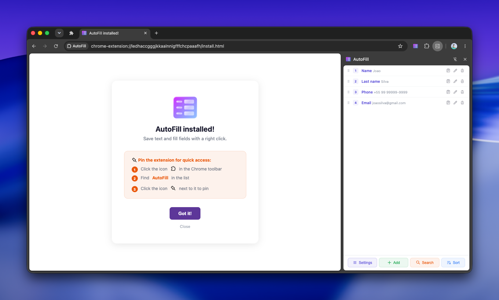
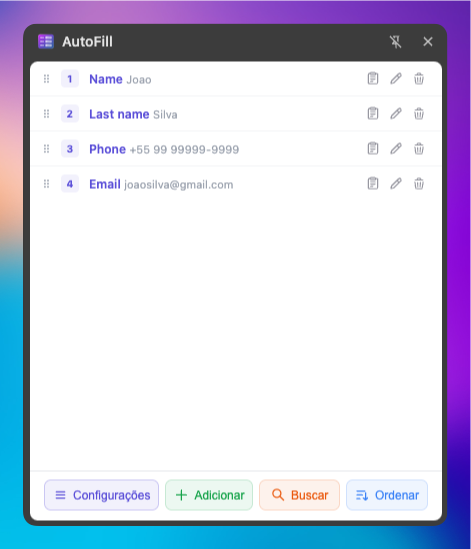
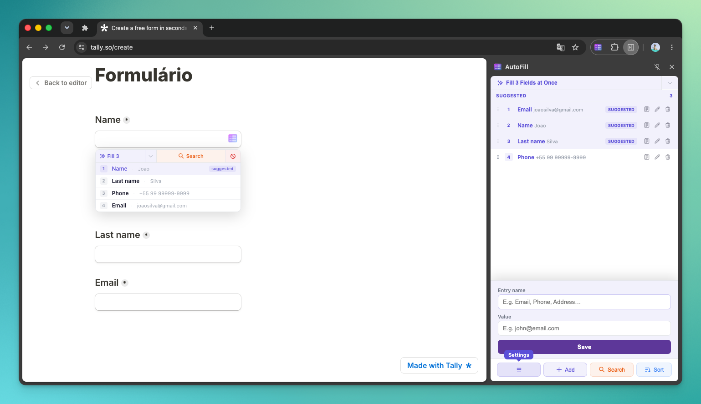
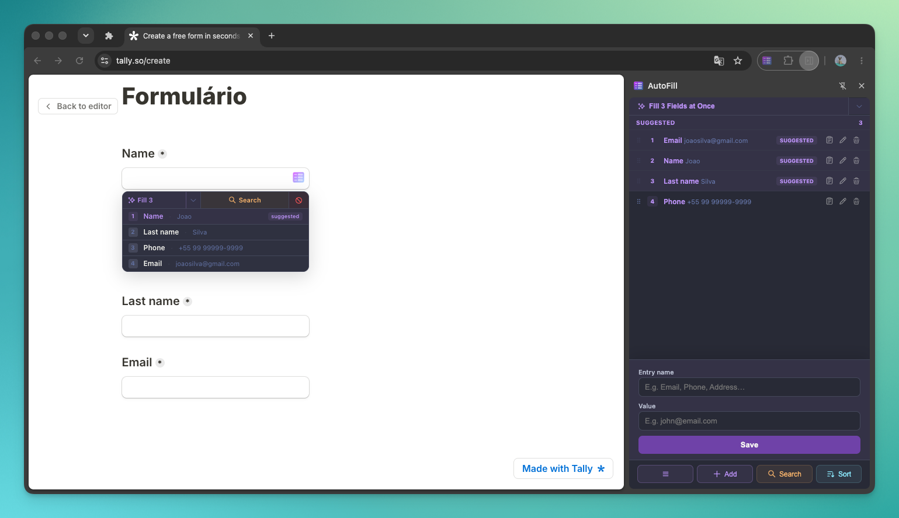
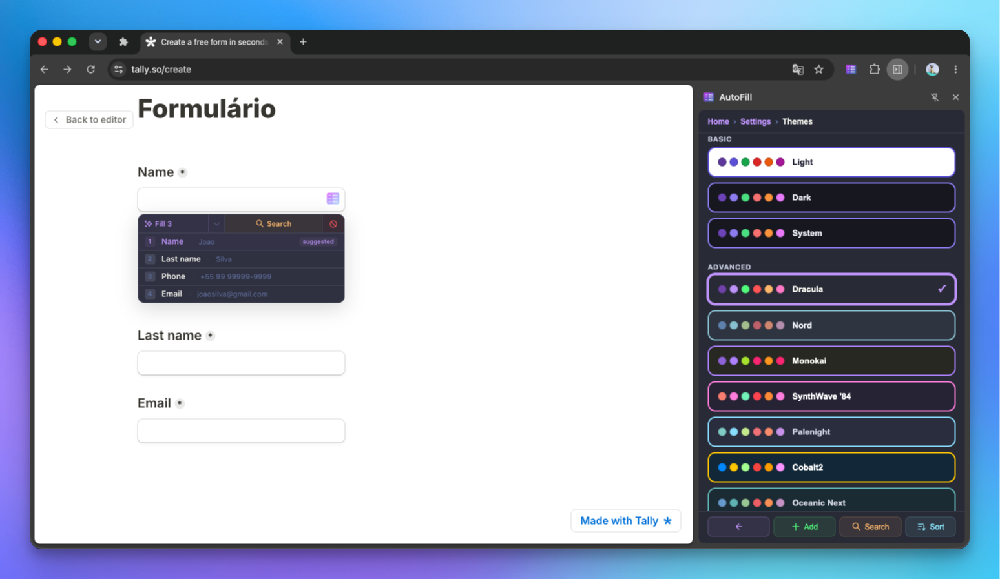
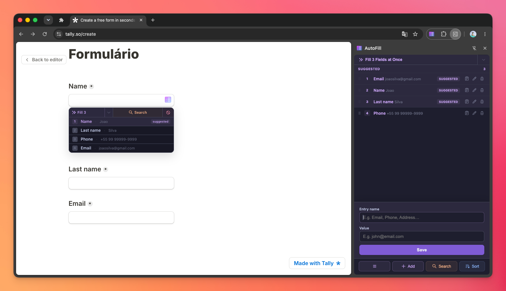
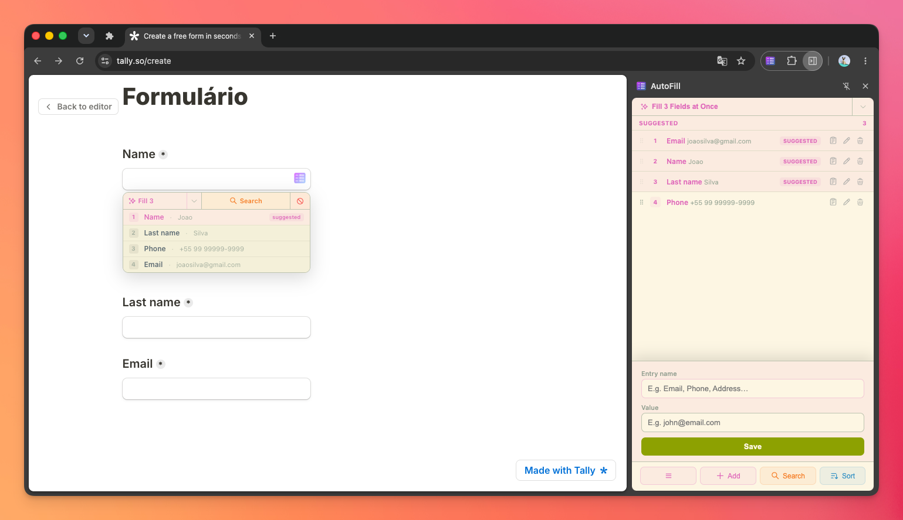
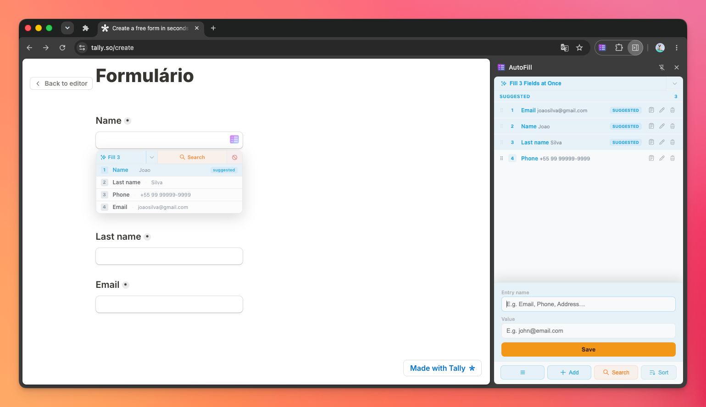

# 🚀 AutoFill

Preencha formulários em segundos com um clique.

Rápido, seguro, gratuito e com seus dados armazenados apenas no seu navegador.

---

## ✨ O que é?

O **AutoFill** é uma extensão para Chrome que permite salvar informações usadas com frequência e preencher formulários em poucos segundos.

É ideal para quem faz muitos cadastros, envia currículos, trabalha com recrutamento ou simplesmente não quer digitar as mesmas informações repetidamente.

Tudo acontece localmente no navegador. Seus dados permanecem sob seu controle.

---

## ⭐ Por que escolher o AutoFill?

O AutoFill foi desenvolvido para tornar o preenchimento de formulários realmente rápido, sem abrir mão da privacidade.

* ⚡ Preencha formulários em segundos
* 🖱️ Escolha entre clique direito ou ícone flutuante
* 🧠 Sugestões inteligentes conforme o campo selecionado
* 📄 Preencha vários campos de uma só vez
* 🔒 Seus dados nunca saem do navegador
* 🌍 Interface em Português, English e Español
* 🔄 Sincronização entre dispositivos usando Chrome Sync
* 🚫 Bloqueio automático em sites sensíveis
* 🎨 Dezenas de temas para deixar a extensão com a sua cara
* 💰 Gratuito para começar, sem anúncios, com upgrade opcional AutoFill+

---

## 🚀 Quick Start

1. **Instale** pela Chrome Web Store.
2. **Adicione** suas informações clicando em "+".
3. **Abra** qualquer formulário.
4. **Escolha** uma das formas de preenchimento.
5. **Pronto!** Seus dados são inseridos automaticamente.

---

## 💡 2 formas de preencher

### 🖱️ Clique direito

Clique com o botão direito sobre qualquer campo e escolha uma das informações salvas.

### 📍 Ícone flutuante

Clique no ícone exibido ao lado do campo para abrir rapidamente suas informações.

---

## ✨ Recursos

### 🚀 Produtividade

* ✅ Informações ilimitadas
* ✅ Preenchimento por clique direito
* ✅ Ícone flutuante
* ✅ Preenchimento de múltiplos campos
* ✅ Sugestões inteligentes por contexto
* ✅ Busca instantânea

### 📂 Organização

* ✅ Editar, excluir e reordenar informações (drag and drop)
* ✅ Detectar campos preenchidos e sugerir salvamento
* ✅ Exportar e importar arquivos JSON
* ✅ Sincronização entre dispositivos com Chrome Sync

### 🌍 Experiência

* ✅ Interface em Português, English e Español
* ✅ Detecção automática do idioma do navegador
* ✅ Troca manual de idioma
* ✅ Tooltips em todos os botões
* ✅ Página de boas-vindas na primeira instalação
* ✅ Dezenas de temas, com modo claro, escuro e automático

---

## 💎 AutoFill+ (Lite vs Pro)

O AutoFill é gratuito e totalmente funcional no plano **Lite**. O **AutoFill+** é um upgrade opcional para quem quer usar sem limites.

| Recurso | Lite (grátis) | AutoFill+ (Pro) |
| --- | --- | --- |
| Entradas salvas | Até 5 | Ilimitadas |
| Sites bloqueados | Até 10 | Ilimitados |
| Bloqueios ativos (locks) | Até 3 | Ilimitados |
| Preencher/salvar vários campos de uma vez | — | ✅ |
| Todos os temas | — | ✅ |
| Exportar e importar dados (JSON) | — | ✅ |
| Ordenação avançada (por tipo/valor) | — | ✅ |

**Preço:** R$ 5,00/mês, cancele quando quiser — sem fidelidade.

A assinatura é gerenciada pelo [ExtPay](https://extensionpay.com), que cuida do pagamento e da autenticação; o AutoFill nunca vê nem armazena dados do seu cartão. Para assinar ou verificar sua assinatura, abra o painel da extensão e vá em **AutoFill+** no menu de configurações.

---

## 🎨 Temas

O AutoFill vem com dezenas de temas prontos, agrupados por família (com variantes de cor selecionáveis) ou como temas independentes — todos com suporte a modo claro, escuro e automático (seguindo o sistema).

---

## 🔒 Segurança & Privacidade

Privacidade faz parte do projeto.

* 🔒 Seus dados ficam armazenados apenas no navegador.
* 🚫 Nenhuma informação é enviada para servidores.
* 👤 Não é necessário criar conta.
* 🔍 Não existe rastreamento.
* 🔑 Senhas nunca são armazenadas.
* 🛡️ Sites sensíveis são bloqueados por padrão, incluindo OpenAI, Google, YouTube e redes sociais.

---

## 📋 Casos de uso

O AutoFill é útil para qualquer pessoa que preencha formulários com frequência.

* 💼 Candidaturas para vagas
* 📄 Plataformas de recrutamento
* 📬 Newsletters
* 🛍️ Cadastros em sites
* 🏠 Endereços recorrentes
* 👤 Dados pessoais
* 🏢 Dados profissionais
* 🔄 Alternar rapidamente entre diferentes perfis

---

## 🌍 Idiomas

A interface está disponível em:

* 🇧🇷 Português (Brasil)
* 🇺🇸 English
* 🇪🇸 Español

O idioma é detectado automaticamente com base no navegador.

Também é possível selecionar manualmente o idioma pelo botão 🌐 disponível no rodapé da extensão.

A preferência é sincronizada automaticamente entre seus dispositivos utilizando o Chrome Sync.

---

## 💡 Por que este projeto existe?

O AutoFill nasceu de uma necessidade simples.

Durante o preenchimento de formulários, principalmente em candidaturas para vagas, era necessário informar repetidamente os mesmos dados, como nome, e-mail, telefone, endereço e outras informações.

Em vez de depender de serviços externos ou armazenar dados na nuvem, foi desenvolvida uma solução simples, rápida e focada em privacidade.

Hoje o projeto é open source e continua evoluindo com base no feedback da comunidade.

---

## ❓ FAQ

### Meus dados são seguros?

Sim. Todas as informações permanecem no seu navegador. O AutoFill não envia seus dados para servidores.

### Funciona em qualquer site?

Na maioria dos sites, sim. Alguns domínios considerados sensíveis são bloqueados por padrão para evitar preenchimentos acidentais.

### Funciona com senhas?

Não. Campos de senha são ignorados por segurança.

### Posso fazer backup das minhas informações?

Sim. Você pode exportar e importar todos os dados utilizando arquivos JSON.

### Posso alterar o idioma?

Sim. O idioma pode seguir automaticamente o navegador ou ser escolhido manualmente.

### O que é o AutoFill+?

É um upgrade opcional (R$ 5,00/mês) que remove os limites do plano Lite (entradas, sites bloqueados e bloqueios ativos) e libera preenchimento em massa, todos os temas, exportar/importar e ordenação avançada. O AutoFill continua gratuito e funcional sem ele.

### Preciso assinar o AutoFill+ para usar a extensão?

Não. O plano Lite é gratuito e cobre o uso básico. O AutoFill+ é só para quem quer usar sem os limites do Lite.

---

## 📜 Licença

MIT © 2026 AutoFill

---

## 🚀 Comece agora

Instale gratuitamente e nunca mais perca tempo digitando as mesmas informações em formulários.

Sem cadastro.

Sem anúncios.

Upgrade para o AutoFill+ é opcional, a partir de R$ 5,00/mês.

